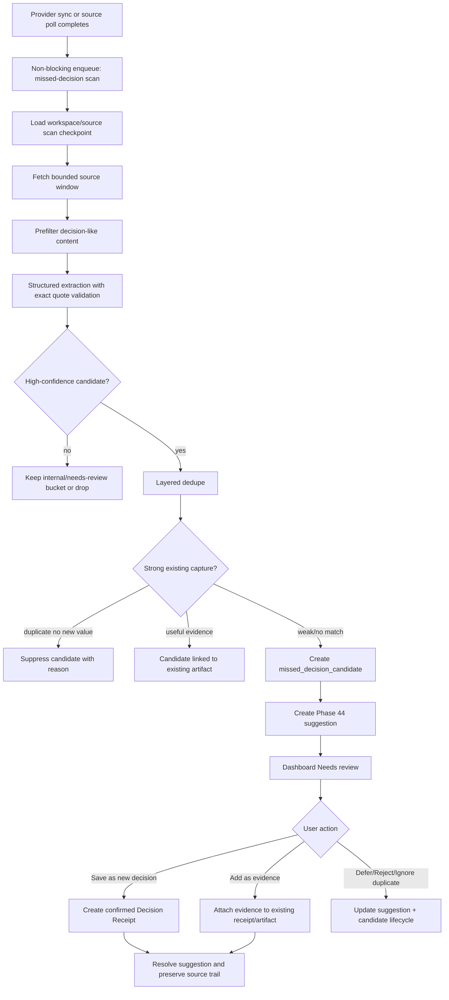

# Phase 45: Post-sync Missed-decision Detection - Research

**Researched:** 2026-05-24  
**Domain:** FastAPI/Supabase background scanning, LLM-assisted extraction, graph-backed Decision Receipts, dashboard suggestions  
**Confidence:** MEDIUM - current sync, graph, extraction, and dashboard patterns are well grounded in local code; the Phase 44 suggestion contract is still pending and must be confirmed before implementation.

<user_constraints>
## User Constraints (from CONTEXT.md)

Copied verbatim from `.planning/phases/45-post-sync-missed-decision-detection/45-CONTEXT.md`. [CITED: .planning/phases/45-post-sync-missed-decision-detection/45-CONTEXT.md]

### Locked Decisions

## Phase Boundary

After relevant source syncs complete, ContextOS scans newly synced workspace content for high-confidence decisions that were discussed but not yet clearly documented, planned, or saved as decision memory. The phase creates missed-decision candidates with source-backed evidence, routes reviewable items through the Phase 44 suggestion surface, and lets users confirm, reject, defer, or add useful evidence to existing artifacts.

This phase depends on Phase 44's durable suggestion model and bounded dashboard suggestion surface. It should not build the confirmed action layer, external write actions, autonomous task/doc creation, or bot action flows. Confirmation means the candidate becomes trusted decision memory first; any action hints are stored for later phases.

## Implementation Decisions

### Scan Trigger and Source Window
- **D-01:** Missed-decision scans should run after relevant source syncs. Conversation and document sources are prioritized first, but the trigger contract can attach to existing provider sync completion events.
- **D-02:** Use per-workspace/per-source `last_missed_decision_scan_at` checkpoints. After a successful source sync, scan newly synced content since the last successful missed-decision scan for that source.
- **D-03:** Only advance `last_missed_decision_scan_at` after the missed-decision scanner succeeds. Provider sync success must not depend on scanner success.
- **D-04:** First scan fallback: if no checkpoint exists, scan the later of source connection time or `now - 14 days`. Do not scan full workspace history by default.
- **D-05:** Slack, Telegram, Fathom, and Notion can originate missed-decision candidates. Tickets, PRs, reviews, and code primarily attach as supporting evidence unless a later phase expands origin sources.
- **D-06:** Scanning runs as a retryable/observable background job after source sync completion. Provider sync should stay fast and successful even when missed-decision scanning fails.

### Candidate Strictness and Dedupe
- **D-07:** Candidate creation should be high-confidence only. Prefer fewer, stronger missed-decision candidates over noisy recall.
- **D-08:** A high-confidence MVP candidate must include exact source passage or decision quote, inferred decision, inferred rationale, and source link.
- **D-09:** People involved, affected workstream/system, and multi-source corroboration enrich confidence and ranking but are not required to surface a candidate.
- **D-10:** Confidence tiers:
  - High: quote/source passage, inferred decision, inferred rationale, and source link.
  - Very high: high-confidence fields plus people/affected system and a supporting source or matching artifact.
  - Needs review: decision-like language with missing rationale or unclear source. Hide by default or place in a separate review bucket.
- **D-11:** Suppress or attach a candidate when the same decision is already clearly represented in an existing Decision node, unresolved/handled suggestion, Linear/Jira ticket, Notion/doc page, or PR. Topical similarity alone is not enough; the artifact must clearly encode the same decision, rationale, or planned action.
- **D-12:** Dedupe works in layers:
  1. Exact/near-exact source quote fingerprint to prevent repeats from the same content.
  2. Normalized semantic fingerprint of inferred decision text to catch paraphrases across sources.
  3. Semantic similarity against existing Decision nodes, suggestions, tickets, docs, and PRs to classify strong, weak, or no match.
  4. Graph neighborhood, including people, systems, projects, tickets, docs, and time window, as confidence booster/tie-breaker only.
- **D-13:** Strong match suppresses the candidate and attaches new source evidence. Weak match surfaces as possible existing capture. No match surfaces as a missed decision.

### Review Surface and Statuses
- **D-14:** Use both a `missed_decision_candidate` record and a generic `suggestion` record. The candidate is the source of truth for detection/provenance/scoring; the suggestion is the user-visible review/action state.
- **D-15:** Candidate owns detected decision, quote/rationale/source links, evidence, confidence, fingerprints/dedupe, scan run, match/suppression status, retry/rescoring history.
- **D-16:** Suggestion owns what the user sees, review state, dismiss/snooze/accept/resolve state, recommended action, and user feedback.
- **D-17:** A suggestion should reference the missed-decision candidate via `entity_type`/`entity_id` or a direct `candidate_id`. Keep Phase 45 detection clean while letting Phase 44 remain a generic suggestion surface for future suggestion types.
- **D-18:** Candidate lifecycle should stay compact: `detected`, `surfaced`, `suppressed`, `linked`, `confirmed`, `rejected`, `deferred`. Operational scan/run state belongs on scan jobs/runs, not the main product lifecycle.
- **D-19:** Review UI actions are Confirm, Reject, Defer, and evidence/duplicate actions. Do not introduce task/doc/PR-comment writes in this phase.
- **D-20:** User-facing labels should be `Add as evidence`, `Ignore duplicate`, and `Save as new decision`; avoid "Link existing" as user-facing language.
- **D-21:** Missed-decision suggestions appear in a bounded post-sync `Needs review` suggestions area on the dashboard, not inside Recent decisions.
- **D-22:** Recent decisions stays reserved for confirmed Decision nodes. Missed-decision suggestions are unconfirmed candidates and need a separate review surface.
- **D-23:** Show the Needs review section after sync completion when open suggestions exist. Display the top 3-5 suggestions with actions: Confirm, Add as evidence, Defer, Reject/Ignore duplicate, plus a later View all route. Hide the section when there are no open suggestions.

### Confirmed Outcome
- **D-24:** When the user confirms a missed decision, first promote/create it as a confirmed Decision node / Decision Receipt and preserve the source trail.
- **D-25:** Confirmation means "this is now trusted decision memory."
- **D-26:** Confirmed Decision Receipt should preserve decision, rationale, source quote/link, confidence, people involved, and affected systems/workstreams.
- **D-27:** After the receipt exists, Phase 45 may record optional action hints such as create task, draft doc/ADR, ask owner, set review date, or save only. These are hints only; Phase 47 turns them into confirmed actions.
- **D-28:** Strong duplicate with no new value should be suppressed automatically with reason `duplicate_no_new_evidence` and no user-visible suggestion.
- **D-29:** Same decision with useful new evidence should surface only if confirmation is needed. Accepting `Add as evidence` marks the candidate `linked`, attaches source quote/rationale/source link to the existing Decision Receipt/task/doc/PR, and resolves the suggestion.
- **D-30:** Weak/ambiguous match should show review choices: Add as evidence, Save as new decision, Ignore duplicate, Dismiss.

### the agent's Discretion

- Planners may choose exact table names, job mechanism, endpoint boundaries, and field shapes as long as the locked candidate/suggestion ownership split is preserved.
- Planners may choose exact confidence thresholds and semantic matching implementation, but must preserve the high-confidence-only user-visible MVP and layered dedupe behavior.
- Planners may decide whether first implementation hides "Needs review" items completely or keeps them in an internal bucket, as long as they do not pollute the main suggestions surface.

### Deferred Ideas (OUT OF SCOPE)

- Create tasks, draft docs/ADRs, ask owners, set review dates, post PR comments, or otherwise execute follow-up actions. These belong to Phase 47 confirmed action layer.
- Expand origin sources so Linear/Jira/GitHub/GitLab comments and reviews can create missed-decision candidates directly. For this phase they primarily attach as supporting evidence.
- Full review page with View all route can follow after the bounded dashboard surface exists.
- Autonomous or low-risk automatic action execution is outside v1.4 Phase 45.
</user_constraints>

<phase_requirements>
## Phase Requirements

| ID | Description | Research Support |
|----|-------------|------------------|
| GAP-01 | After source sync completes, scan recent synced content for likely decisions discussed but not documented/planned. [CITED: .planning/REQUIREMENTS.md] | Existing sync services emit `sync_completed` or equivalent ingestion milestones, and the scheduler already supports supervised background workers. [VERIFIED: codebase grep] |
| GAP-02 | User can review candidate with linked source evidence, confidence, people involved, affected workstreams. [CITED: .planning/REQUIREMENTS.md] | Existing LLM extraction includes exact `source_quote`, rationale, confidence, person, and ticket refs; the graph model can represent people, tickets, docs, PRs, and Decision nodes. [VERIFIED: codebase grep] |
| GAP-03 | User can confirm/reject/defer candidate. [CITED: .planning/REQUIREMENTS.md] | Phase 44 must provide durable suggestion state; Phase 45 should add candidate-specific action endpoints that update candidate lifecycle plus suggestion review state. [CITED: .planning/phases/45-post-sync-missed-decision-detection/45-CONTEXT.md] |
| GAP-04 | Confirmed missed decisions can become source-backed Decision Receipt or follow-up suggestion without losing evidence trail. [CITED: .planning/REQUIREMENTS.md] | Existing graph `Decision` nodes already store JSONB properties such as rationale/source quote/confidence, and dashboard decision rendering reads those properties. [VERIFIED: codebase grep] |
</phase_requirements>

## Summary

Phase 45 should be planned as a backend-owned detection pipeline that runs after successful source sync or ingestion completion, creates durable missed-decision candidates, and routes only high-confidence user-visible items into the Phase 44 suggestion system. [CITED: .planning/phases/45-post-sync-missed-decision-detection/45-CONTEXT.md] The implementation should reuse existing workspace-scoped sync, LLM extraction, graph upsert, embedding/search, and dashboard patterns instead of creating a parallel product queue. [VERIFIED: codebase grep]

The central planning dependency is Phase 44: the repo currently has no implemented Phase 44 artifact beyond the phase directory placeholder, so Phase 45 must either wait for Phase 44 schema/endpoints/UI to exist or start with a Wave 0 contract checkpoint. [VERIFIED: codebase grep] Do not plan a second standalone review queue; the locked model is candidate records for detection/provenance plus suggestion records for user-visible state. [CITED: .planning/phases/45-post-sync-missed-decision-detection/45-CONTEXT.md]

**Primary recommendation:** Build `missed_decision_scan_runs` plus `missed_decision_candidates` in the Python API/Supabase layer, enqueue scans non-blockingly from source sync/poll completion, use exact-quote-validated extraction and layered dedupe, then publish top candidates to Phase 44 suggestions for bounded dashboard review. [VERIFIED: codebase grep]

## Project Constraints (from AGENTS.md)

- No repo-local `AGENTS.md` exists in `/Users/dauletashikbayev/Developer/ContextOS-core`; the active instruction was supplied by the user in this turn. [VERIFIED: codebase grep]
- The supplied AGENTS instruction requires proactive OneContext/Aline history search for existing code, features, past decisions, debugging context, or prior project history. [CITED: user-provided AGENTS.md instruction]
- Aline history was searched for exact Phase 45 and missed-decision terms and found no relevant exact matches; historical Phase 41/42 decisions from planning/memory still apply to dashboard hierarchy and Decision Receipt semantics. [VERIFIED: aline search]
- No repo-local `.codex/skills` or `.agents/skills` directory was found, so no project-local skill conventions need to be merged into this research. [VERIFIED: codebase grep]

## Architectural Responsibility Map

| Capability | Primary Tier | Secondary Tier | Rationale |
|------------|--------------|----------------|-----------|
| Source sync completion detection | API / Backend | Database / Storage | Provider sync services and the sync scheduler own `sync_completed` events, cursor status, and polling completion. [VERIFIED: codebase grep] |
| Missed-decision scan scheduling | API / Backend | Redis / Database | Background workers already run under FastAPI lifespan, and Redis is already used for lock-style scheduler coordination. [VERIFIED: codebase grep] |
| Scan checkpoints and run observability | Database / Storage | API / Backend | `last_missed_decision_scan_at`, scan status, retry metadata, and error state must survive process restarts. [CITED: .planning/phases/45-post-sync-missed-decision-detection/45-CONTEXT.md] |
| Candidate extraction, scoring, and dedupe | API / Backend | Database / Storage | LLM extraction, exact-quote validation, graph/embedding lookups, and suppression classification are server-side trust boundaries. [VERIFIED: codebase grep] |
| Generic suggestion review state | Database / Storage | API / Backend | Phase 44 owns generic suggestion state; Phase 45 only references candidates from that surface. [CITED: .planning/phases/45-post-sync-missed-decision-detection/45-CONTEXT.md] |
| Dashboard `Needs review` surface | Browser / Client | API / Backend | The React dashboard owns bounded rendering and actions, while server endpoints own authenticated mutations. [VERIFIED: codebase grep] |
| Decision Receipt promotion | API / Backend | Database / Storage | Confirmation must create/update graph `Decision` nodes and preserve evidence with workspace-scoped writes. [VERIFIED: codebase grep] |

## Standard Stack

### Core

| Library / System | Version | Purpose | Why Standard |
|------------------|---------|---------|--------------|
| FastAPI | 0.133.0 | Authenticated scanner/action endpoints and background orchestration. | Existing API framework and lifespan worker owner. [VERIFIED: local environment] |
| Pydantic | 2.12.5 | Candidate extraction schemas, action request/response models, validation. | Existing schema system used by the API and LLM extraction models. [VERIFIED: local environment] |
| SQLModel | 0.0.37 | New candidate/scan-run models and workspace-scoped ORM access. | Existing backend model style for graph, sync, and source tables. [VERIFIED: local environment] |
| SQLAlchemy | 2.0.46 | Async DB sessions, transactions, savepoints, and direct queries. | Existing persistence layer under SQLModel. [VERIFIED: local environment] |
| Supabase Postgres + RLS | Supabase CLI 2.75.0 locally | Durable candidate, scan-run, suggestion, graph, and evidence storage. | Project standard storage/auth/RLS boundary. [CITED: .planning/PROJECT.md] |
| Existing LLM extraction services | Project-local services | Strict decision extraction with rationale, source quote, confidence, person, and refs. | `llm_extractor.py` already validates exact quotes and persists graph decisions; Phase 45 should adapt it for unconfirmed candidates. [VERIFIED: codebase grep] |
| Existing graph services | Project-local services | Decision Receipt creation, source/evidence relationships, dedupe context. | `graph_ops.py` provides workspace-scoped node/edge upserts with fingerprint dedupe. [VERIFIED: codebase grep] |
| Next.js | 15.5.12 | Dashboard suggestion surface and action UI. | Existing web app framework and dashboard route owner. [VERIFIED: local environment] |
| React | 19.2.4 | Client components for bounded `Needs review` cards and actions. | Existing frontend component/runtime stack. [VERIFIED: local environment] |

### Supporting

| Library / System | Version | Purpose | When to Use |
|------------------|---------|---------|-------------|
| Supabase JS | 2.97.0 | Frontend auth token/session access and Realtime subscriptions. | Use existing `apiFetch` pattern for authenticated API mutations; use Realtime only if Phase 44 suggestions subscribe live. [VERIFIED: local environment] |
| Redis Python client | 7.2.0 | Optional scan lock, queue guard, or retry coordination. | Use if the scan worker needs cross-process locking, matching existing digest scheduler style. [VERIFIED: local environment] |
| pgvector / hybrid search | Existing migration | Semantic similarity against embeddings within workspace. | Use for semantic dedupe against existing source/artifact embeddings; do not add a second vector store. [VERIFIED: codebase grep] |
| rapidfuzz | Existing backend dependency | Near-exact text similarity for normalized decision/quote matching. | Use for cheap local dedupe thresholds before expensive semantic lookup. [VERIFIED: codebase grep] |
| Vitest | 4.0.18 | Frontend unit/component tests. | Use for dashboard suggestion rendering and action behavior. [VERIFIED: local environment] |
| pytest | 9.0.2 | Backend unit/integration tests. | Use for scanner checkpoint, candidate lifecycle, dedupe, and action endpoints. [VERIFIED: local environment] |

### Alternatives Considered

| Instead of | Could Use | Tradeoff |
|------------|-----------|----------|
| New vector database | pgvector hybrid search | Use existing Postgres embeddings; adding a second vector system increases workspace isolation and ops risk. [VERIFIED: codebase grep] |
| Celery/RQ queue | FastAPI lifespan worker plus DB scan-run table | Project explicitly uses FastAPI background tasks/no Celery, so adding Celery contradicts stack constraints. [CITED: .planning/PROJECT.md] |
| Direct graph Decision creation during scan | Candidate + suggestion + confirmation action | Direct creation would violate the locked rule that confirmation means trusted decision memory. [CITED: .planning/phases/45-post-sync-missed-decision-detection/45-CONTEXT.md] |
| `dashboard_resurfaced.py` as user-visible source | Strict extractor + dedupe + high-confidence gate | Existing heuristic is broad and useful only as an internal prefilter. [VERIFIED: codebase grep] |

**Installation:**

No new external packages are recommended for Phase 45. [VERIFIED: codebase grep]

```bash
# No npm install / uv add required.
```

**Version verification:** Versions above were checked from the local environment and project manifests with `uv run --directory backend`, `pnpm --dir apps/web`, and package manifests. [VERIFIED: local environment]

## Package Legitimacy Audit

No external packages need to be installed for this phase, so the package legitimacy gate is not applicable. [VERIFIED: codebase grep]

| Package | Registry | Age | Downloads | Source Repo | slopcheck | Disposition |
|---------|----------|-----|-----------|-------------|-----------|-------------|
| none | — | — | — | — | — | No install required |

**Packages removed due to slopcheck [SLOP] verdict:** none  
**Packages flagged as suspicious [SUS]:** none

## Architecture Patterns

### System Architecture Diagram



This flow follows the locked split between scanner/candidate ownership and Phase 44 suggestion ownership. [CITED: .planning/phases/45-post-sync-missed-decision-detection/45-CONTEXT.md]

### Recommended Project Structure

```text
backend/src/models/
├── missed_decision.py        # Scan run, scan state, candidate, optional candidate evidence models

backend/src/services/
├── missed_decision_scanner.py    # Source-window loading, extraction, scoring, dedupe, candidate creation
├── missed_decision_actions.py    # Confirm/reject/defer/add-evidence mutations
└── missed_decision_sources.py    # Slack/Telegram/Fathom/Notion source adapters and links

backend/src/routers/
└── missed_decisions.py      # Authenticated API endpoints, if not folded into Phase 44 suggestion router

supabase/migrations/
└── 000xx_missed_decisions.sql    # RLS-backed candidate/scan-run/schema additions

apps/web/src/app/dashboard/pulse/
└── needs-review-suggestions.tsx  # Bounded top 3-5 post-sync review section

apps/web/src/lib/
└── missed-decisions.ts      # Typed fetch/action helpers if the codebase keeps route helpers separate
```

### Pattern 1: Durable Scan Run and Checkpoint

**What:** Store scanner operational state separately from product candidate lifecycle. [CITED: .planning/phases/45-post-sync-missed-decision-detection/45-CONTEXT.md]

**When to use:** Every post-sync scan should create/update a scan-run row and advance the per-workspace/per-source checkpoint only after candidate extraction/dedupe commits. [CITED: .planning/phases/45-post-sync-missed-decision-detection/45-CONTEXT.md]

**Example:**

```python
# Source: backend/src/services/sync_adapter.py and Phase 45 D-02/D-03.
async def run_missed_decision_scan(session, workspace_id, source_type, synced_until):
    state = await get_or_create_scan_state(session, workspace_id, source_type)
    window_start = state.last_missed_decision_scan_at or fallback_window_start(source_type)
    run = await create_scan_run(session, workspace_id, source_type, window_start, synced_until)

    try:
        candidates = await scan_source_window(session, workspace_id, source_type, window_start, synced_until)
        await persist_candidates_and_suggestions(session, run.id, candidates)
        state.last_missed_decision_scan_at = synced_until
        run.status = "complete"
        await session.commit()
    except Exception as exc:
        run.status = "failed"
        run.error_message = str(exc)
        await session.commit()
        raise
```

### Pattern 2: Exact Quote Validation Before Candidate Creation

**What:** Treat source quote validation as a hard anti-hallucination gate. [VERIFIED: codebase grep]

**When to use:** Before saving a candidate or surfacing a suggestion, the scanner should prove the cited passage exists in the source record content. [VERIFIED: codebase grep]

**Example:**

```python
# Source: backend/src/services/llm_extractor.py.
def validate_candidate_quote(source_text: str, source_quote: str) -> bool:
    normalized_source = " ".join(source_text.lower().split())
    normalized_quote = " ".join(source_quote.lower().split())
    return normalized_quote in normalized_source
```

### Pattern 3: Candidate Promotion Creates Trusted Decision Memory

**What:** Confirmation promotes the candidate to a graph `Decision` node/Decision Receipt and resolves the review state. [CITED: .planning/phases/45-post-sync-missed-decision-detection/45-CONTEXT.md]

**When to use:** Use for `Save as new decision`; use evidence attachment instead for `Add as evidence`. [CITED: .planning/phases/45-post-sync-missed-decision-detection/45-CONTEXT.md]

**Example:**

```python
# Source: backend/src/services/graph_ops.py and apps/web dashboard decision mapping.
node = await upsert_node(
    session,
    workspace_id=candidate.workspace_id,
    entity_type="Decision",
    name=candidate.decision_title,
    source_type=candidate.source_type,
    source_id=candidate.source_id,
    properties={
        "description": candidate.inferred_decision,
        "rationale": candidate.inferred_rationale,
        "source_quote": candidate.source_quote,
        "source_link": candidate.source_link,
        "confidence": candidate.confidence,
        "people": candidate.people_involved,
        "affected_systems": candidate.affected_systems,
        "status": "confirmed",
    },
)
```

### Anti-Patterns to Avoid

- **Advancing scanner checkpoint during provider sync:** This loses unscanned content when the scanner fails after sync succeeds. [CITED: .planning/phases/45-post-sync-missed-decision-detection/45-CONTEXT.md]
- **Creating confirmed graph Decisions directly from scans:** This bypasses user confirmation and breaks the Decision Receipt trust contract. [CITED: .planning/phases/45-post-sync-missed-decision-detection/45-CONTEXT.md]
- **Putting unconfirmed candidates in Recent decisions:** Phase 41/45 require Recent decisions to remain confirmed Decision nodes only. [CITED: .planning/phases/41-dashboard-pulse-redesign/41-CONTEXT.md]
- **Running expensive LLM scans inside provider sync transactions:** Provider sync must remain successful even when scanner execution fails. [CITED: .planning/phases/45-post-sync-missed-decision-detection/45-CONTEXT.md]
- **Using topical similarity as a duplicate by itself:** The locked dedupe contract requires same decision/rationale/planned action, not only related topic. [CITED: .planning/phases/45-post-sync-missed-decision-detection/45-CONTEXT.md]

## Don't Hand-Roll

| Problem | Don't Build | Use Instead | Why |
|---------|-------------|-------------|-----|
| Workspace isolation | Ad hoc `workspace_id` filters in only some queries | Existing `UserContext`, Supabase JWT, RLS, and workspace-scoped model patterns | The product is multi-tenant and every model/query must be workspace-scoped. [CITED: .planning/PROJECT.md] |
| Decision extraction schema | Free-form LLM text parsing | Existing Pydantic structured extraction plus exact source-quote validation | The repo already has anti-hallucination extraction primitives. [VERIFIED: codebase grep] |
| Semantic dedupe infrastructure | New vector store or custom ANN index | Existing pgvector embeddings and `hybrid_search` migration | Supabase/Postgres is already the storage/search boundary. [VERIFIED: codebase grep] |
| Graph persistence | Custom graph tables | Existing `graph_nodes`, `graph_edges`, `upsert_node`, and `upsert_edge` | Existing Decision Receipt/dashboard code reads graph Decision nodes. [VERIFIED: codebase grep] |
| Suggestion UI state | Second review queue | Phase 44 generic suggestion record | Phase 45 locked candidate/suggestion split requires generic suggestion ownership for review state. [CITED: .planning/phases/45-post-sync-missed-decision-detection/45-CONTEXT.md] |
| Background supervision | Celery/RQ scheduler | Existing FastAPI lifespan/scheduler and DB run state | Project constraints call for FastAPI background tasks/no Celery. [CITED: .planning/PROJECT.md] |

**Key insight:** The hard problem is not "find decision-like text"; it is preserving trust boundaries: exact evidence, workspace isolation, dedupe against existing memory/artifacts, and user confirmation before a candidate becomes a Decision Receipt. [CITED: .planning/phases/45-post-sync-missed-decision-detection/45-CONTEXT.md]

## Common Pitfalls

### Pitfall 1: Treating Phase 44 as Already Implemented
**What goes wrong:** Planner references suggestion models/endpoints/components that do not exist yet. [VERIFIED: codebase grep]  
**Why it happens:** ROADMAP says Phase 45 depends on Phase 44, but the repo currently has no concrete Phase 44 artifact beyond the placeholder phase directory. [VERIFIED: codebase grep]  
**How to avoid:** Start with a Wave 0 dependency checkpoint that reads Phase 44 implementation artifacts or defines an explicit interface once Phase 44 lands. [ASSUMED]  
**Warning signs:** Phase 45 plan creates `suggestions` and candidate UI in the same task without checking Phase 44 ownership. [ASSUMED]

### Pitfall 2: Reusing Daily Digest as the Scanner
**What goes wrong:** The digest service creates graph Decision nodes immediately and lacks exact candidate source-link/evidence lifecycle semantics. [VERIFIED: codebase grep]  
**Why it happens:** The digest service already extracts decisions from messages, but it is designed for daily digest generation, not unconfirmed missed-decision review. [VERIFIED: codebase grep]  
**How to avoid:** Reuse useful strictness and prompt lessons, but save candidates first and only promote on confirmation. [CITED: .planning/phases/45-post-sync-missed-decision-detection/45-CONTEXT.md]  
**Warning signs:** Scan output calls `upsert_node(entity_type="Decision")` before a user action. [VERIFIED: codebase grep]

### Pitfall 3: Surfacing Broad Heuristic Matches
**What goes wrong:** Users see noisy "we should" or "consider" suggestions that are not real decisions. [VERIFIED: codebase grep]  
**Why it happens:** `dashboard_resurfaced.py` is intentionally heuristic and broader than Phase 45's high-confidence MVP. [VERIFIED: codebase grep]  
**How to avoid:** Use heuristics only to reduce source rows before strict extraction, not as final user-visible candidates. [ASSUMED]  
**Warning signs:** Candidates lack exact quote, rationale, or source link. [CITED: .planning/phases/45-post-sync-missed-decision-detection/45-CONTEXT.md]

### Pitfall 4: Assuming Every Source Has a Clean External Link
**What goes wrong:** High-confidence candidates fail source-link validation for sources like Telegram or Fathom when no external permalink exists. [VERIFIED: codebase grep]  
**Why it happens:** Slack has permalink resolution helpers, while Telegram/Fathom/Notion source-link capabilities differ by integration. [VERIFIED: codebase grep]  
**How to avoid:** Normalize `source_link` as best available navigable evidence: external permalink when available, otherwise an internal source-detail reference that still preserves workspace and source record identity. [ASSUMED]  
**Warning signs:** Scanner drops otherwise strong candidates only because a provider lacks Slack-style permalinks. [ASSUMED]

### Pitfall 5: Cross-Workspace Evidence Leakage
**What goes wrong:** A candidate dedupes against or links to another workspace's Decision, ticket, or source record. [ASSUMED]  
**Why it happens:** The scanner touches graph, embeddings, suggestions, and source rows; any missing workspace predicate is a security bug. [CITED: .planning/PROJECT.md]  
**How to avoid:** Every SQL query, graph lookup, embedding search, suggestion mutation, and source link resolution must include `workspace_id` and use RLS-backed tables. [CITED: .planning/PROJECT.md]  
**Warning signs:** Helper functions accept only `source_id` or `node_id` without `workspace_id`. [ASSUMED]

### Pitfall 6: Telegram Source-Type Graph Drift
**What goes wrong:** Telegram-derived context attaches to a generic/fallback source type rather than a first-class Telegram source node. [VERIFIED: codebase grep]  
**Why it happens:** Current graph source-type mapping does not fully model `telegram_message` as a dedicated source entity. [VERIFIED: codebase grep]  
**How to avoid:** Add or verify source mapping before relying on graph neighborhood as a confidence booster for Telegram candidates. [ASSUMED]  
**Warning signs:** Telegram candidates have poor people/workstream enrichment despite message ingestion succeeding. [ASSUMED]

## Code Examples

Verified patterns from local sources:

### Source-Aware Scanner Adapter

```python
# Source: backend/src/models/slack.py, backend/src/models/telegram.py,
# backend/src/models/notion.py, backend/src/models/meeting.py.
class MissedDecisionSourceRecord(BaseModel):
    source_type: Literal["slack_message", "telegram_message", "meeting_transcript", "notion_page"]
    source_id: UUID
    workspace_id: UUID
    text: str
    author_name: str | None = None
    source_created_at: datetime
    source_link: str | None = None
    raw_metadata: dict[str, Any] = Field(default_factory=dict)
```

### Candidate Status and Dedupe Fields

```python
# Source: Phase 45 D-14 through D-18.
class MissedDecisionCandidate(SQLModel, table=True):
    __tablename__ = "missed_decision_candidates"

    id: UUID = Field(default_factory=uuid4, primary_key=True)
    workspace_id: UUID = Field(index=True)
    scan_run_id: UUID = Field(index=True)
    source_type: str = Field(index=True)
    source_id: UUID = Field(index=True)
    source_quote: str
    inferred_decision: str
    inferred_rationale: str
    confidence: str
    quote_fingerprint: str = Field(index=True)
    decision_fingerprint: str = Field(index=True)
    lifecycle_status: str = Field(default="detected", index=True)
    suppression_reason: str | None = None
    matched_entity_type: str | None = None
    matched_entity_id: UUID | None = None
    evidence: dict[str, Any] = Field(default_factory=dict, sa_column=Column(JSONB))
```

### Authenticated Action Endpoint Shape

```python
# Source: backend/src/routers patterns and apps/web/src/lib/api.ts.
@router.post("/{candidate_id}/confirm")
async def confirm_missed_decision(
    candidate_id: UUID,
    request: ConfirmMissedDecisionRequest,
    user: UserContext = Depends(get_current_user),
    session: AsyncSession = Depends(get_session),
):
    candidate = await get_candidate_for_workspace(session, user.workspace_id, candidate_id)
    decision_node = await promote_candidate_to_decision(session, candidate, request)
    await resolve_related_suggestion(session, candidate.id, resolution="confirmed")
    await session.commit()
    return {"decision_node_id": str(decision_node.id)}
```

### Frontend Action Helper

```typescript
// Source: apps/web/src/lib/api.ts.
export async function confirmMissedDecision(candidateId: string) {
  return apiFetch<{ decision_node_id: string }>(
    `/missed-decisions/${candidateId}/confirm`,
    { method: "POST" },
  )
}
```

## State of the Art

| Old Approach | Current Approach | When Changed | Impact |
|--------------|------------------|--------------|--------|
| Activity/digest surfaces create or show context without explicit user confirmation. | Missed-decision candidates stay untrusted until user confirmation creates a Decision Receipt. | Phase 45 context, 2026-05-24. [CITED: .planning/phases/45-post-sync-missed-decision-detection/45-CONTEXT.md] | Planner must separate extraction from confirmed memory creation. |
| Dashboard home could show broad activity/suggestions. | Dashboard hierarchy is quiet: computed pulse, Recent decisions, Active context, bounded Needs review. | Phase 41 context. [CITED: .planning/phases/41-dashboard-pulse-redesign/41-CONTEXT.md] | Candidate UI must be compact and separate from Recent decisions. |
| Ticket/PR/doc objects could be treated as primary product object. | Decision Receipt/source-backed decision memory is the product-proof primitive; tickets/PRs/docs are proof/supporting surfaces. | Phase 42 context and memory. [CITED: .planning/phases/42-landing-positioning-and-seo-launch-rewrite/42-CONTEXT.md] | Confirmed candidates should become Decision Receipts first, with optional action hints later. |
| Direct action execution after extraction. | Optional action hints only; Phase 47 owns confirmed action execution. | Phase 45 context. [CITED: .planning/phases/45-post-sync-missed-decision-detection/45-CONTEXT.md] | Do not write tasks, docs, PR comments, or owner pings in Phase 45. |

**Deprecated/outdated:**
- Treating `messages_digest` decisions as enough for missed-decision detection is insufficient because Phase 45 needs candidate review lifecycle, linked source evidence, dedupe classification, and suggestion actions. [VERIFIED: codebase grep]
- Treating Recent decisions as a catch-all "decision-like" surface contradicts Phase 41/45 dashboard constraints. [CITED: .planning/phases/41-dashboard-pulse-redesign/41-CONTEXT.md]

## Assumptions Log

| # | Claim | Section | Risk if Wrong |
|---|-------|---------|---------------|
| A1 | Phase 44 will provide a generic suggestion table/model, statuses, dashboard surface, and action endpoints that Phase 45 can reference. | Summary, Standard Stack, Architecture Patterns | Phase 45 schema/UI tasks may need to absorb more suggestion-system work or wait for Phase 44. |
| A2 | `source_link` may be an internal navigable evidence reference when an integration lacks an external permalink. | Common Pitfalls | High-confidence candidate requirements could be interpreted as requiring only external links, dropping Telegram/Fathom candidates. |
| A3 | Existing embeddings/hybrid search are sufficient for semantic dedupe once thresholds are calibrated. | Don't Hand-Roll | If embeddings are incomplete for source/artifact types, planner must add backfill or fallback matching tasks. |
| A4 | Decision Receipt remains represented by graph `Decision` nodes plus JSONB properties in this phase. | Architecture Patterns | If a later phase introduces a separate receipt table, promotion tasks need different persistence. |
| A5 | FastAPI lifespan workers and DB run-state are enough for retryable/observable scanning without a new queue package. | Standard Stack | If production concurrency needs exceed current scheduler patterns, planner must add queue design work. |

## Open Questions (RESOLVED)

1. **What exact Phase 44 suggestion schema and endpoint contract will exist?**
   - What we know: Phase 45 is locked to use generic suggestions for user-visible review state. [CITED: .planning/phases/45-post-sync-missed-decision-detection/45-CONTEXT.md]
   - What's unclear: No Phase 44 implementation artifact exists in the repo yet. [VERIFIED: codebase grep]
   - Selected resolution: Wave 0 blocks Phase 45 implementation until the reusable Phase 44 suggestion contract exists and is approved. The contract must include workspace-scoped suggestion storage, statuses, entity reference shape, action endpoints/service helpers, and the bounded dashboard surface; Phase 45 must not create a second review queue. [CITED: .planning/phases/45-post-sync-missed-decision-detection/45-CONTEXT.md]

2. **Should evidence attachment be normalized or stored as JSONB?**
   - What we know: Graph nodes already use JSONB properties, and candidate evidence needs source quote/link/rationale/person/system history. [VERIFIED: codebase grep]
   - What's unclear: Long-term evidence may need many-to-one relationships across candidates, decisions, docs, tickets, and PRs. [ASSUMED]
   - Selected resolution: Store canonical normalized missed-decision candidate/evidence rows as the durable source of truth, then copy a compact source trail into graph `Decision` node properties for current dashboard rendering. The compact trail should include source quote, source link or internal source reference, rationale, confidence, people, affected systems/workstreams, candidate ID, and scan run ID. [ASSUMED]

3. **Which LLM path should be canonical for Phase 45?**
   - What we know: `digest.py` uses the general LLM client for daily extraction, while `llm_extractor.py` has stronger quote-validation semantics and Gemini-specific calls. [VERIFIED: codebase grep]
   - What's unclear: The project stack docs mention both OpenAI and Gemini responsibilities, and local code currently spans both. [VERIFIED: codebase grep]
   - Selected resolution: Reuse `llm_extractor.py` schema and exact-quote validation guarantees, and route provider choice through the existing LLM client where possible. Do not add a new LLM package or standalone provider client for Phase 45. [ASSUMED]

4. **How should weak/needs-review candidates be retained?**
   - What we know: User-visible MVP should be high-confidence only; "Needs review" may be hidden or internal. [CITED: .planning/phases/45-post-sync-missed-decision-detection/45-CONTEXT.md]
   - What's unclear: Whether retaining lower-confidence internal candidates is worth storage/cost in v1.4. [ASSUMED]
   - Selected resolution: Persist high and very-high surfaced/suppressed candidates. Do not surface `needs_review` candidates. Keep only aggregate lower-confidence diagnostics on scan runs unless a specific debugging path needs retained sample data. [CITED: .planning/phases/45-post-sync-missed-decision-detection/45-CONTEXT.md]

## Environment Availability

| Dependency | Required By | Available | Version | Fallback |
|------------|-------------|-----------|---------|----------|
| Node.js | Web tests/build tooling | yes | v26.0.0 local | Project Docker/Corepack uses Node 20; use project container if local version causes Next.js drift. [VERIFIED: local environment] |
| pnpm | Web package scripts | yes | 10.28.2 local | Project docs/map mention pnpm 9; use Corepack or CI command if lockfile behavior differs. [VERIFIED: local environment] |
| uv | Backend Python commands | yes | 0.10.2 | None needed. [VERIFIED: local environment] |
| Python backend deps | API/tests | yes | FastAPI 0.133.0, Pydantic 2.12.5, SQLModel 0.0.37, SQLAlchemy 2.0.46 | None needed. [VERIFIED: local environment] |
| Supabase CLI/local stack | Migrations and local DB/RLS validation | yes | CLI 2.75.0, local stack running | CLI reports newer versions exist; planner can still use local stack unless migration behavior requires upgrade. [VERIFIED: local environment] |
| Docker | Supabase/local services | yes | 28.4.0 | None needed. [VERIFIED: local environment] |
| redis-cli | Manual Redis probing | no | — | Use Docker service logs or Python Redis client; implementation does not require `redis-cli`. [VERIFIED: local environment] |
| Context7 / ctx7 | External docs lookup | no | — | Not needed; local codebase supplied the relevant API/pattern facts. [VERIFIED: local environment] |

**Missing dependencies with no fallback:** none.  
**Missing dependencies with fallback:** `redis-cli`, `ctx7`.

## Validation Architecture

### Test Framework

| Property | Value |
|----------|-------|
| Backend framework | pytest 9.0.2. [VERIFIED: local environment] |
| Backend config file | `backend/pyproject.toml`. [VERIFIED: codebase grep] |
| Backend quick run command | `uv run --directory backend pytest backend/tests/test_missed_decisions.py -x`. [ASSUMED] |
| Backend full suite command | `uv run --directory backend pytest`. [VERIFIED: codebase grep] |
| Frontend framework | Vitest 4.0.18. [VERIFIED: local environment] |
| Frontend config file | `apps/web/vitest.config.ts`. [VERIFIED: codebase grep] |
| Frontend quick run command | `pnpm --dir apps/web exec vitest run src/app/dashboard/pulse/needs-review-suggestions.test.tsx`. [ASSUMED] |
| Frontend full suite command | `pnpm --dir apps/web test`. [VERIFIED: codebase grep] |
| Type check command | `pnpm --dir apps/web typecheck`. [VERIFIED: codebase grep] |

### Phase Requirements -> Test Map

| Req ID | Behavior | Test Type | Automated Command | File Exists? |
|--------|----------|-----------|-------------------|--------------|
| GAP-01 | Successful source sync/poll enqueues scanner, scanner uses bounded source window, checkpoint advances only after scanner success. | Backend unit/integration | `uv run --directory backend pytest backend/tests/test_missed_decision_scanner.py -x` | no - Wave 0 |
| GAP-02 | Candidate includes quote/source link/confidence/people/affected workstreams and appears in bounded suggestion payload. | Backend unit + frontend component | `uv run --directory backend pytest backend/tests/test_missed_decision_candidates.py -x` and `pnpm --dir apps/web exec vitest run src/app/dashboard/pulse/needs-review-suggestions.test.tsx` | no - Wave 0 |
| GAP-03 | Confirm/reject/defer/add-evidence actions update candidate lifecycle and related suggestion state. | Backend endpoint tests | `uv run --directory backend pytest backend/tests/test_missed_decision_actions.py -x` | no - Wave 0 |
| GAP-04 | Confirmed candidate creates/updates graph Decision Receipt and preserves evidence trail. | Backend integration | `uv run --directory backend pytest backend/tests/test_missed_decision_promotion.py -x` | no - Wave 0 |

### Sampling Rate

- **Per task commit:** Run the narrow backend or frontend command for the touched layer. [ASSUMED]
- **Per wave merge:** Run `uv run --directory backend pytest` plus `pnpm --dir apps/web test` for backend+web waves. [ASSUMED]
- **Phase gate:** Full backend suite, web tests, and `pnpm --dir apps/web typecheck` should pass before `$gsd-verify-work`. [ASSUMED]

### Wave 0 Gaps

- [ ] `backend/tests/test_missed_decision_scanner.py` - covers GAP-01 scanner trigger/window/checkpoint. [ASSUMED]
- [ ] `backend/tests/test_missed_decision_candidates.py` - covers GAP-02 candidate payload/scoring/dedupe fields. [ASSUMED]
- [ ] `backend/tests/test_missed_decision_actions.py` - covers GAP-03 action transitions and suggestion resolution. [ASSUMED]
- [ ] `backend/tests/test_missed_decision_promotion.py` - covers GAP-04 graph Decision Receipt promotion/evidence preservation. [ASSUMED]
- [ ] `apps/web/src/app/dashboard/pulse/needs-review-suggestions.test.tsx` - covers bounded top 3-5 dashboard surface and actions. [ASSUMED]

## Security Domain

### Applicable ASVS Categories

| ASVS Category | Applies | Standard Control |
|---------------|---------|------------------|
| V2 Authentication | yes | Use Supabase Auth JWT and existing FastAPI `get_current_user`/`UserContext` dependency. [VERIFIED: codebase grep] |
| V3 Session Management | yes | Frontend `apiFetch` obtains session token from Supabase and sends authenticated API requests with `cache: "no-store"`. [VERIFIED: codebase grep] |
| V4 Access Control | yes | New tables require `workspace_id`, RLS policies, and server-side workspace predicates on every read/write. [CITED: .planning/PROJECT.md] |
| V5 Input Validation | yes | Use Pydantic v2 request models and enum/lifecycle validation for candidate/suggestion actions. [VERIFIED: local environment] |
| V6 Cryptography | yes | Do not hand-roll token crypto; keep provider credentials in existing Supabase/Vault patterns. [CITED: .planning/PROJECT.md] |
| V8 Data Protection | yes | Source quotes may contain sensitive internal content and must be scoped, auditably accessed, and never leaked across workspaces. [CITED: .planning/PROJECT.md] |
| V10 Malicious Code | yes | Treat synced source text as untrusted user content; LLM prompts must include prompt-injection guardrails and exact quote validation. [VERIFIED: codebase grep] |

### Known Threat Patterns for FastAPI/Supabase/LLM Scanner

| Pattern | STRIDE | Standard Mitigation |
|---------|--------|---------------------|
| Cross-workspace candidate/evidence leakage | Information Disclosure | `workspace_id` on every table, RLS policies, server-side workspace predicates, and no client-supplied workspace trust. [CITED: .planning/PROJECT.md] |
| Prompt injection from Slack/Telegram/Notion/Fathom source text | Tampering | Keep source text inside explicit "untrusted content" prompt boundaries and require exact quote validation before persistence. [VERIFIED: codebase grep] |
| Hallucinated decisions or rationale | Tampering | Require exact quote/source passage, inferred rationale, source link, and confidence tier before user-visible suggestion. [CITED: .planning/phases/45-post-sync-missed-decision-detection/45-CONTEXT.md] |
| Duplicate spam / suggestion flooding | Denial of Service | Layer quote fingerprints, decision fingerprints, semantic similarity, and graph-neighborhood tie-breakers before surfacing. [CITED: .planning/phases/45-post-sync-missed-decision-detection/45-CONTEXT.md] |
| Unauthorized confirm/reject/defer | Elevation of Privilege | Mutations must use authenticated user context and verify candidate/suggestion workspace ownership. [VERIFIED: codebase grep] |
| XSS through source quote rendering | Tampering | Render quotes as text in React, never via HTML injection; keep markdown/rich source rendering out of MVP. [ASSUMED] |
| Provider sync failure caused by scanner failure | Denial of Service | Enqueue scanner non-blockingly; provider sync success must not depend on scanner success. [CITED: .planning/phases/45-post-sync-missed-decision-detection/45-CONTEXT.md] |

## Sources

### Primary (HIGH confidence)

- `.planning/phases/45-post-sync-missed-decision-detection/45-CONTEXT.md` - locked decisions, boundaries, candidate/suggestion split, UI/status constraints.
- `.planning/REQUIREMENTS.md` - GAP-01 through GAP-04 and v1.4 boundaries.
- `.planning/ROADMAP.md` - Phase 45 dependency on Phase 44 and success criteria.
- `.planning/PROJECT.md` - stack/product/security boundaries.
- `.planning/codebase/STACK.md` - project stack map.
- `.planning/codebase/ARCHITECTURE.md` - sync scheduler, graph, activity, and workspace-scoped architecture.
- `.planning/codebase/INTEGRATIONS.md` - provider/source integration map.
- `backend/src/services/sync_adapter.py` - sync cursor/status/activity helper patterns.
- `backend/src/services/sync_scheduler.py` - supervised source polling and digest scheduling patterns.
- `backend/src/services/llm_extractor.py` - exact quote validation, structured decision extraction, graph persistence.
- `backend/src/services/digest.py` - strict decision extraction prompt and daily digest graph creation.
- `backend/src/services/graph_ops.py` and `backend/src/models/graph_node.py` - workspace-scoped graph upsert patterns.
- `apps/web/src/app/dashboard/page.tsx`, `apps/web/src/app/dashboard/pulse/recent-decisions.tsx`, `apps/web/src/app/dashboard/decisions/decision-node.ts` - dashboard and Decision Receipt rendering patterns.

### Secondary (MEDIUM confidence)

- Aline/OneContext history search - no exact Phase 45/missed-decision matches found; Phase 41/42 historical direction still reinforces dashboard/Decision Receipt constraints.
- Local environment probes - current tool versions and availability.

### Tertiary (LOW confidence)

- Assumptions listed in the Assumptions Log about Phase 44 interface shape, source-link fallback, semantic thresholds, and evidence normalization.

## Metadata

**Confidence breakdown:**
- Standard stack: HIGH - local package manifests and runtime version probes confirm the stack; no new packages are needed.
- Architecture: MEDIUM - scanner/graph/sync patterns are verified, but Phase 44's concrete suggestion interface is not present yet.
- Pitfalls: HIGH for local-code pitfalls, MEDIUM for Phase 44 contract risks because implementation is pending.
- Validation: MEDIUM - test frameworks exist, but Phase 45-specific tests are greenfield.
- Security: HIGH for workspace/RLS/auth constraints, MEDIUM for LLM-specific mitigation details until scanner prompt/schema is finalized.

**Research date:** 2026-05-24  
**Valid until:** 2026-06-23
