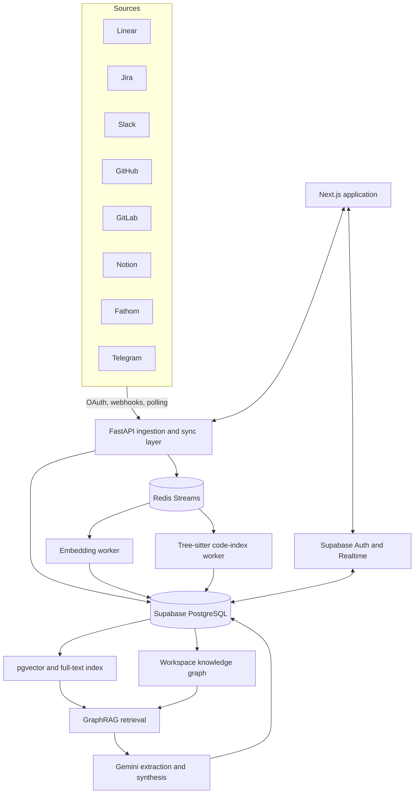

<p align="center">
  
</p>

<h1 align="center">ContextOS</h1>

<p align="center">
  <strong>Decision memory for engineering teams.</strong>
</p>

<p align="center">
  ContextOS connects the evidence scattered across tickets, conversations, meetings,
  documentation, pull requests, and source code—then turns it into source-backed
  decision records, ticket context, and an explorable knowledge graph.
</p>

<p align="center">
  <a href="https://contextos.pro">Website</a>
</p>

> [!NOTE]
> ContextOS is an early-stage product under active development. The hosted product is currently in early access.

## What is ContextOS?

Engineering teams rarely lose the final decision. They lose the reasoning behind it.

A requirement may begin in a meeting, change in Slack, become a Linear or Jira ticket,
get implemented in a pull request, and end up reflected in code without any single
place preserving the complete story. Months later, a teammate has to reconstruct:

- What was decided?
- Why was that choice made?
- Who was involved?
- Which systems and tickets were affected?
- Has the work already been implemented?
- Which original sources prove the answer?

ContextOS sits behind the tools a team already uses. It continuously connects
engineering artifacts and produces verifiable context without replacing the existing
workflow.

## What ContextOS produces

### Source-backed decision records

ContextOS extracts product and engineering decisions, rationale, participants,
affected systems, confidence, and source evidence. Decision records retain links to
the original discussion, ticket, meeting, document, or code-review artifact.

### Ticket context pages

For a Linear ticket or Jira issue, ContextOS can generate a structured context page
containing:

- Summary and context-density assessment
- Background and decision history
- Requirements and their implementation status
- Implementing and related pull requests
- Related or potentially duplicate tickets
- Relevant files, functions, classes, and routes
- Risks, blockers, conflicts, and information gaps
- Open questions
- Key people and their cross-source involvement
- Links and citations to original evidence

Context generation streams live progress to the product UI and stores the completed
page for later review.

### Decision graph

The workspace knowledge graph connects entities including:

- People
- Tickets
- Decisions
- Blockers
- Pull requests and merge requests
- Slack threads and Telegram conversations
- Meetings
- Notion pages
- Code symbols
- Features and components

Relationships record references, mentions, authorship, assignment, discussion,
implementation, review, decisions, blockers, identity equivalence, parenthood, and
evidence. The graph explorer supports workspace-wide exploration and focused views
for personal work, active sprints, and blocked work.

### Missed-decision review

After source synchronization, ContextOS can scan recent conversations, documents,
and meeting evidence for important decisions that were discussed but were not
captured in a durable artifact.

Candidates are validated against exact source quotes, deduplicated against existing
decisions and work items, and sent to a review workflow where a user can confirm,
defer, reject, attach evidence, or mark a duplicate.

### Code intelligence

Selected GitHub and GitLab repositories are cloned temporarily and parsed with
Tree-sitter. ContextOS extracts symbol-level chunks—functions, classes, methods,
interfaces, types, traits, structs, and enums—and links them to relevant tickets,
discussions, decisions, and pull requests.

The parser recognizes 23 languages across 32 file extensions, including Python,
TypeScript, JavaScript, Go, Rust, Java/JVM languages, C/C++, C#, Swift, Ruby, PHP,
Dart, Haskell, Lua, Bash, Zig, and Solidity.

### Cross-platform identity and communities

ContextOS resolves the same teammate across connected providers so evidence from a
ticket, chat, meeting, or code review points to one person. A scheduled Louvain
community-detection job groups strongly related people and work, with human-readable
labels and summaries for qualifying clusters.

## Integrations

| Source | What ContextOS ingests | Connection model |
|---|---|---|
| Linear | Teams, tickets, comments, status, and assignee data | OAuth, GraphQL, webhooks, reconciliation |
| Jira | Issues, comments, projects, and status data | OAuth 2.0, JQL, webhooks |
| Slack | Selected channels, DMs, threads, reactions, edits, and huddle transcripts | OAuth, Events API, polling fallback |
| GitHub | Repositories, pull requests, reviews, and source code | GitHub App, webhooks, asynchronous indexing |
| GitLab | Projects, merge requests, reviews, and source code | OAuth, webhooks, asynchronous indexing |
| Notion | Selected pages and block content | OAuth, webhooks, reconciliation polling |
| Fathom | Meetings, transcripts, summaries, speakers, and participants | Workspace API key, polling |
| Telegram | Paired chats and messages | Shared bot, pairing codes, webhook ingestion |

## How it works

1. **Connect sources**
   A workspace connects the tools where engineering work already happens.

2. **Synchronize evidence**
   OAuth integrations, provider webhooks, background jobs, and polling
   reconciliation ingest new and changed artifacts.

3. **Build the knowledge layer**
   ContextOS creates embeddings, extracts structured entities, resolves people
   across providers, and updates a workspace-scoped knowledge graph.

4. **Retrieve relevant context**
   The GraphRAG engine combines direct references, vector and full-text search,
   and graph traversal.

5. **Synthesize with provenance**
   Google Gemini generates structured ticket context and decision records while
   preserving source attribution, conflicts, uncertainty, and information gaps.

6. **Review and explore**
   Users inspect context pages, decision records, graph relationships, source
   freshness, and missed-decision suggestions in the dashboard.

## Architecture



### GraphRAG retrieval

ContextOS does more than nearest-neighbor vector search. Its retrieval pipeline
combines:

1. **Explicit evidence** — ticket identifiers, foreign-key relationships, linked
   PRs/MRs, comments, URLs, mentions, and code references.
2. **Hybrid search** — Gemini embeddings through pgvector combined with PostgreSQL
   full-text search.
3. **Graph traversal** — recursive traversal through related people, decisions,
   blockers, tickets, discussions, meetings, documentation, PRs, and code.

The pipeline additionally uses:

- Hypothetical Document Embeddings (HyDE)
- Reciprocal Rank Fusion
- Gemini-based reranking
- Graph-depth decay
- Freshness and verification scoring
- Suppression of stale, superseded, or generated-source noise
- Signal-diverse token budgeting
- Retrieval provenance and selection explanations

### Knowledge-graph construction

Graph construction combines two extraction layers:

- Deterministic extractors for ticket references, mentions, PR/commit references,
  file paths, and URLs
- Gemini structured extraction for decisions and blockers, validated against exact
  source quotes

Nodes use deterministic fingerprints for idempotent ingestion. Cross-platform
identities are resolved primarily through email-based mappings, while similar names
remain candidates instead of being merged automatically.

## Technology stack

| Area | Technologies |
|---|---|
| Frontend | Next.js 15, React 19, TypeScript, Tailwind CSS 4, Radix UI, XYFlow, ELK |
| Backend | Python 3.12, FastAPI, Pydantic, SQLModel, async SQLAlchemy, asyncpg |
| AI | Google Gemini generation, structured extraction, and 768-dimensional embeddings |
| Retrieval | GraphRAG, pgvector, PostgreSQL full-text search, HyDE, RRF, LLM reranking |
| Graph | PostgreSQL graph tables, recursive CTEs, NetworkX, Louvain communities |
| Data platform | Supabase PostgreSQL, Auth, Realtime, Vault, Row Level Security |
| Asynchronous work | Redis Streams and supervised background workers |
| Observability | Sentry, Langfuse, Laminar, PostHog, structured logging, correlation IDs |
| Production | Docker Compose, nginx, Let's Encrypt, Hetzner, GitHub Actions |

## Repository structure

```text
ContextOS-core/
├── apps/web/                 Next.js product, dashboard, auth, graph UI, and landing page
├── backend/
│   ├── src/routers/          FastAPI endpoints
│   ├── src/services/         Sync, retrieval, AI, graph, and worker services
│   ├── src/models/           SQLModel database models
│   ├── src/evals/            Deterministic AI evaluation runners
│   ├── evals/datasets/       Labeled GraphRAG and missed-decision fixtures
│   └── tests/                Backend test suite
├── supabase/
│   ├── migrations/           Database schema, RLS, search, graph, and Vault migrations
│   └── config.toml           Local Supabase configuration
├── packages/mcp-server/      Experimental MCP adapter
├── scripts/                  Development, migration, and production helper scripts
├── nginx/                    Production reverse-proxy configuration
├── docker-compose.yml        Local Redis
└── docker-compose.prod.yml   Production application stack
```

## Local development

### Prerequisites

- Node.js 22+
- pnpm 9+
- Python 3.12+
- [uv](https://docs.astral.sh/uv/)
- Docker
- [Supabase CLI](https://supabase.com/docs/guides/local-development/cli/getting-started)
- [ngrok](https://ngrok.com/) for OAuth callbacks and webhooks

### Setup

```bash
git clone https://github.com/contextOS-team/ContextOS-core.git
cd ContextOS-core

cp .env.example .env
```

Fill in the local Supabase values, a Gemini API key, and credentials for the
integrations you want to test. Provider integrations are optional and can be
configured independently. Never commit `.env` or share production credentials.

Then run:

```bash
make setup
make dev
```

Local services:

- Web application: `http://localhost:3000`
- FastAPI documentation: `http://localhost:8000/docs`
- Supabase Studio: `http://localhost:54323`
- Frontend log: `.openlogs/frontend.txt`
- Backend log: `.openlogs/backend.txt`

`make dev` starts local Supabase, Redis, the frontend, and the backend. It also
starts ngrok when `NGROK_DOMAIN` is configured.

### Useful commands

| Command | Description |
|---|---|
| `make setup` | Install dependencies and initialize the local stack |
| `make dev` | Run the complete development environment |
| `make dev-frontend` | Run only the Next.js application |
| `make dev-backend` | Run only the FastAPI backend |
| `make dev-ngrok` | Run the configured ngrok tunnel |
| `make db-reset` | Recreate the local database and apply migrations |
| `make test` | Run backend tests |
| `make lint` | Run frontend and backend linting |
| `make typecheck` | Run TypeScript and Python type checks |
| `make eval-graph-rag` | Run deterministic GraphRAG evaluations |
| `make eval-missed-decisions` | Run deterministic missed-decision evaluations |

Run frontend tests directly with:

```bash
cd apps/web
pnpm exec vitest run
```

## AI evaluation

ContextOS separates operational tracing from quality evaluation.

The repository contains deterministic labeled datasets for:

- GraphRAG retrieval and provenance
- Missed-decision detection and source validation

The GraphRAG evaluator measures recall, source-link accuracy, stale-source
violations, noise, provenance completeness, workspace isolation, streaming parity,
and action grounding.

The missed-decision evaluator measures precision, recall, exact source grounding,
payload completeness, and actionability metadata.

These evaluation paths do not call a live model or make external provider writes.

## Security design

ContextOS includes:

- Supabase Auth with email/password, Google, and GitHub sign-in
- JWT verification through Supabase JWKS, with legacy HS256 support
- Workspace-scoped database access and PostgreSQL Row Level Security
- OAuth tokens and workspace secrets stored through Supabase Vault
- Signed OAuth state values
- Provider webhook signature or secret-token verification
- Webhook-delivery idempotency
- Redis-backed rate limiting on public integration endpoints
- Salted, hashed workspace API keys
- Security headers and HTTPS enforcement
- Audit logging for context generation and review actions
- Production configuration validation and root-only secret files

These controls describe the current implementation. They are not a claim of SOC 2
or another compliance certification.

## Deployment

Production runs on Hetzner using Docker Compose. nginx terminates TLS with Let's
Encrypt certificates and routes the Next.js application and FastAPI API. Pushes to
`main` currently trigger the GitHub Actions deployment workflow, which applies
pending database migrations, rebuilds the application images, restarts the stack,
and performs health checks.

Deployment configuration is intentionally separate from local development. Never
derive or overwrite a production environment file from `.env.example`.

## Experimental surfaces and roadmap

The repository contains an MCP adapter and Chrome extension implementation. They
should currently be treated as experimental developer surfaces rather than stable,
supported distribution channels.

The next product layer is focused on confirmed actions—drafting or creating
follow-up work, documentation updates, owner confirmations, and PR context comments
while keeping external writes reviewable.

## License

No software license has been published yet. Until a license is added, the source is
publicly viewable but remains all rights reserved.
